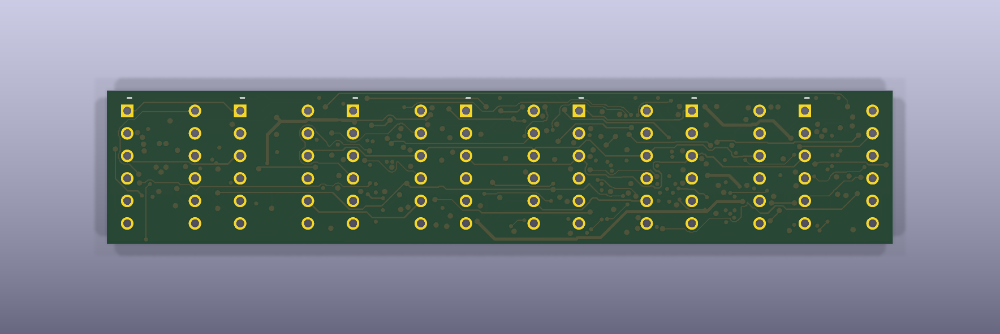
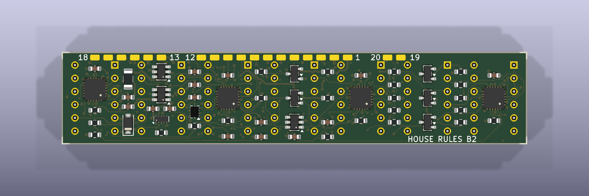

# B2 — lower-cost hardware revision

This is the separate cost-reduction revision of the House Rules display. The original A1 design is preserved at the Git tag [`hardware-a1-2026-10-29`](https://github.com/hmcneill46/house-rules-led-recreation/tree/hardware-a1-2026-10-29). Do not mix A1 and B2 firmware, wiring, placement files or fabrication files.

**30 October update: do not order the current PCB; module spacing is under physical review.** New owner photos show the fitted strip bowing, although each module's individual 12-hole pattern fits. The earlier positive fit report did not establish a stress-free seven-module assembly. The owner has now narrowed the required pitch to 12.80–12.90 mm following the [earlier A/B/C trials](printing/pitch-tests-2026-10-30/README.md). The [new labelled D/E/F trials](printing/fine-pitch-tests-2026-10-30/README.md) test 12.825/12.850/12.875 mm. Confirm the winning pitch, then recheck PCB placement/routing, the enclosure and quotation before ordering. Existing fabrication files and case models retain the old 12.70 mm repeat as historical prototypes.

The canonical PCB still passes native KiCad DRC and schematic parity with zero reported violations or missing connections. The [manufacturing review package](manufacturing/B2_review/README.md) records that unchanged design and its hashes. These software results do not resolve the new physical spacing issue. Factory CAM/placement review and first-board acceptance also remain requirements. No order or payment has been submitted.

## What stays the same

- Seven owned Wenrun 5 × 7 LED modules, arranged side by side, make the same 35 × 7 display. The smallest stress-free module spacing is being tested.
- The existing prototype main PCB is **88.4 × 17.3 × 1.6 mm**, with 84 LED holes at the old 12.70 mm repeat. Its final module spacing and combined mechanical fit are pending the new trials.
- The case remains **93.6 × 22.6 × 24 mm**, with a bottom-right USB-C port. The stock socket moves its centre about 4.7 mm left within that face.
- The supplied program uses the original artwork, timing and orientation. It also includes walking-pixel, all-on and checkerboard diagnostics. Firmware can be replaced repeatedly with other text or animations.

The owner reports that the individual 12-hole pattern fits, but the 30 October photos supersede the earlier assumption that seven modules fit without stress at 12.70 mm pitch. Module spacing and final enclosure fit remain unresolved. The owner separately verified all 12 terminal roles/order and electrical orientation on one real module using the UT0021YB diode test: **part-number label on the left in front view**. [Physical pin-map evidence](reports/owner-led-diode-test-2026-10-29.json). That electrical evidence remains valid; the other 20 modules still need consistent checks.

## What changes and why it costs less

| A1 | B2 |
| --- | --- |
| Custom STM32 controller on the main board | Ready-assembled Seeed XIAO RP2040 Plus |
| Second custom USB PCB and assembly job | Ready-assembled Adafruit 4090 USB-C breakout |
| Fine 0.20 mm via drills | Ordinary 0.30 mm drills, mostly 0.60 mm copper pads with selected 0.45 mm escapes |
| Four autonomous matrix drivers | Four regulated TLC59282 sinks and five scan switches, refreshed by the MCU |
| Two custom PCBA setups | One custom PCBA setup |

The MCU and USB breakout sit behind the main board, retained by the printed case. Their components are already soldered. All **55 small components on the custom main board** are assigned to the factory. The owner fits seven LEDs and connects the modules with **20 wires**, which means 40 wire joints plus 84 LED joints per display. No bare QFN chip is assigned to hand soldering. Wire pads need strain relief and short exposed conductors.

The finished layout uses six layers, ground reference planes and filled/capped thermal vias without the A1 small-drill surcharge. All 276 via drills are 0.30 mm; 167 copper capture pads are 0.60 mm and 109 tight escapes use 0.45 mm pads. JLCPCB lists the latter as a standard via combination. In4 stays ground-only; In2 has a single 9.754 mm quiet timing-capacitor connection while retaining one connected ground fill. Layer count alone does not determine the cheapest useful prototype.

These are native KiCad renders of the actual routed board. The first hides the LED bodies to expose their holes; the second shows the factory component side. Models simplify package shapes and are not photographs.

## Cost evidence

The [final routed-board JLCONE quotation](quotes/final-review-2026-10-29/README.md) uses the actual routed Gerbers, exact 55-component BOM and native placement file. All 18 BOM groups matched. It uses six-layer ENIG fabrication, ordinary 0.30 mm drills, filled/capped vias and bottom-side Economic assembly. It provides **five PCBs in total, two populated and three bare**:

- Quotation screen: **$49.94 fabrication + $49.90 assembly = $99.84** before shipping/VAT.
- Actual checkout: **$97.52 goods + $1.50 UK shipping + $19.81 VAT = $118.83**, before coupons, approximately **£89.08**. [Checkout proof](quotes/final-review-2026-10-29/checkout-summary-before-coupon.png).
- The cart omitted exactly the quoted **$2.32 depanel fee**, even though the saved job retains depanel **Yes**. Allowing for that fee and its VAT gives a conservative JLC delivered budget of **$121.62**, approximately **£91.17**. This discrepancy is not counted as a confirmed saving.
- Stock MCU and USB modules, estimated UK delivery included: **£14.78 for one set**, **£22.17 for two sets**.
- Conservative complete-display budget: **£105.95 for one display plus a spare populated main**, or **£113.34 for two displays**, using the already-owned LEDs. Minor assembly supplies, cable and power supply are extra.

Those figures count the two populated boards as part of the five-PCB batch, not seven boards. The other three are bare spares; do not assume the factory will populate already-delivered bare boards later without another assembly order. A larger populated batch needs a fresh component-stock check, particularly the TLC drivers. The factory's minimum Economic assembly batch is two, so a one-display prototype still includes a spare populated main.

The earlier same-parts [native quote](quotes/cost-study-basic-iref-2026-10-29/native-55-quote.json) was $121.62 delivered before coupons. Its [web checkout fallback](quotes/cost-study-basic-iref-2026-10-29/quote-summary.json) uses $5.88 shipping and is $126.88 including VAT (approximately £117.28 for two complete displays with retail modules). Promotions may expire or have account/channel limits.

The earlier [four-layer/49-component study](quotes/cost-study-2026-10-29/4L-two-assembled-quote.json) was cheaper but was not the final routed/thermal/charger-compatible design. It remains as historical price evidence. Selecting six layers avoids treating a dense unfilled-via layout as production-ready merely because its early quote is lower.

A claimed $30 high-layer coupon was accepted in a same-account cart preview. Its final deduction, shipping-promotion interaction and VAT recalculation require the later payment stage, so **no coupon is deducted above**. There is no verified stronger creator code in the research. No order was submitted to reach that payment stage.

Wire, solder, screws, filament, USB cable and power supply are extra. JLCPCB charges USD; the payment exchange rate can differ. Final routing, available stock and manufacturing review can change the quotation. Coupons have not been subtracted from those totals. See [module price and shipping evidence](../../cost-down/module-shipping-quote.json).

## Power and programming

The external USB-C port carries 5 V power and USB 2 data. It uses the breakout's separate CC pull-down resistors; no higher-voltage USB Power Delivery negotiation is required. A Type-C source qualified by the ADC thresholds, a computer granting the requested 500 mA USB configuration, or the BQ24392's valid charging-source indication enables full brightness. A USB data cable is required for programming.

The current Type-C thresholds are deliberately conservative. A valid advertisement at the low end of the 1.5 A range can remain dim/off; the chosen standalone supply needs checks in both plug orientations. A compatible 5 V / 3 A Type-C source has more detection margin while the display still draws only its own load. See the [ADC threshold review](reports/type-c-adc-threshold-review.md). These thresholds can be calibrated in firmware without buying a revised PCB.

The RP2040 alone has no BC1.2 charger detector. An early B2 study therefore stayed dim on an ordinary A-to-C charging port. The final circuit adds a **BQ24392 detector and USB data switch** to restore that capability. Its two status outputs must jointly indicate charging permission, stable for 100 ms; a real computer's suspend state overrides every source grant. Unknown sources retain the conservative prototype dim/off policy until actual current measurements qualify it.

The RP2040 ROM bootloader accepts a UF2 file copied to its `RPI-RP2` drive. Program the loose XIAO before closing the case. USB serial can request the bootloader later; opening the rear gives access to BOOT/RESET if recovery is needed. See the [firmware instructions](firmware/README.md).

## Evidence and remaining physical checks

The editable schematic has zero ERC violations, with all 327 connected pins matched against its connection source. The final native PCB DRC reports zero violations, zero unconnected items and zero schematic parity issues. The separate board audit passes all 82 references, the exact A1 84-hole LED geometry, open LED holes, all 276 filled/capped vias, 12 driver thermal vias and physical drill clearances. The actual exported Excellon independently contains exactly 276 × 0.30 mm vias and 84 × 0.90 mm open LED holes. No custom DRC exclusions are used; KiCad's five native default ignored checks are documented explicitly in the package.

Compiled firmware and an independent pin-level simulation reproduce all 245 walking pixels and 60,000 artwork frames. These results check represented geometry, digital mapping and timing logic, not actual powered-board operation or analog electronics.

One owned module's polarity and complete pin map are now physically confirmed. The first PCB assembly still needs supply/current and real USB suspend measurements, enumeration/programming checks, scan-edge/ghosting checks and an all-on temperature test inside the case. The conservative prototype firmware has separate rail shutdown and an input soft start; those circuits and software do not establish measured USB compliance.

Relevant sources and results:

- [Editable KiCad project](kicad/house-rules-main-B2.kicad_pro), [PCB](kicad/house-rules-main-B2.kicad_pcb), [schematic](kicad/house-rules-main-B2.kicad_sch)
- [Final verification summary](reports/final-verification-summary.json), [native DRC](reports/final-drc.json), [separate PCB audit](reports/board-audit.json)
- [Manufacturing review package](manufacturing/B2_review/README.md), [Gerber/drill archive](manufacturing/B2_review/house-rules-main-B2-fabrication-REVIEW.zip), [exact BOM](manufacturing/B2_review/assembly/bom.csv), [placement review](manufacturing/B2_review/assembly/placement-review.csv)
- [Owner assembly and first-test guide](assembly-and-test.md)
- [Electrical design and assumptions](electrical-review.md)
- [Independent physical-connection simulation](simulation/README.md)
- [Firmware, tests and compiled UF2](firmware/README.md)
- [Case assembly and printable models](mechanical/README.md)
- [Ender-3 V3 KE / grey Hyper PLA case and fit-test G-code](printing/README.md)
- [Stock module mechanical contract](stock-module-contract.json)
- [USB/module power audit](reports/usb-suspend-module-audit.md)
