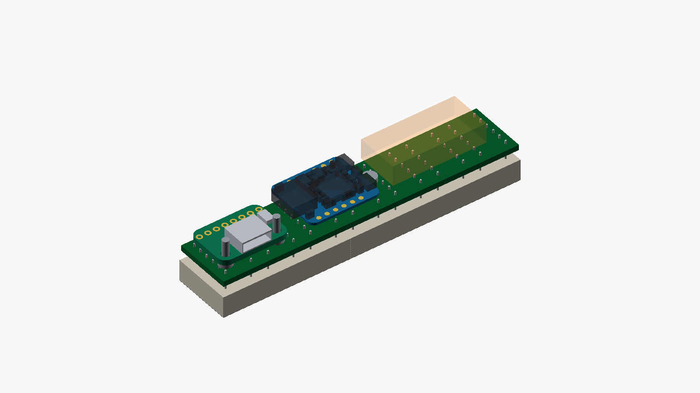
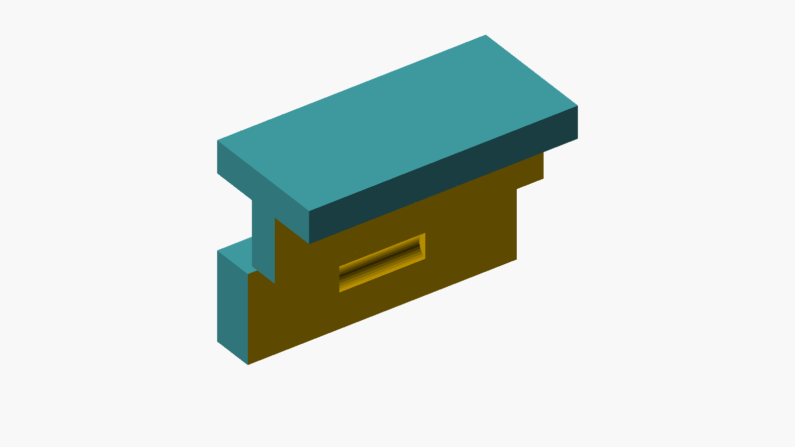
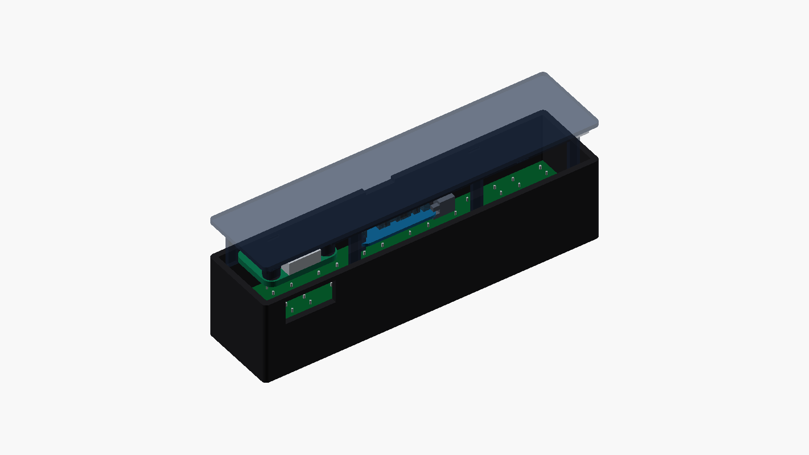

# B2 enclosure and stock-module assembly

This prototype keeps the original **93.6 × 22.6 × 24 mm** outside dimensions, front opening and seven-module appearance. The 88.4 × 17.3 mm custom mounting PCB remains behind the nominal 88.9 × 17.8 mm LED silhouette. The separate custom USB board is replaced by an Adafruit 4090; a Seeed XIAO RP2040 **Plus** fits beside it on the removable rear cover. These are engineering renders of source-derived board envelopes, not photographs or a promise that an unmeasured module revision fits.

The owner has physically verified all 12 pin roles/order on one `LMD07057AUE-101B-02`; its correct upright front view has the part-number label on the **left**. Orient the other modules consistently and check them against that reference before soldering. The other 20 modules remain unverified. [Owner diode-test record](../reports/owner-led-diode-test-2026-10-29.json).



The USB-C port stays on the bottom toward the right when viewed from the display front. Its centre is x=78.16 mm, about 4.65 mm left of A1. The socket face is 2.35 mm behind the outer wall in a 14 × 6.5 mm plug well; there is a closed 1.3 mm roof above it. Check the intended cable's moulding in the print before fitting electronics. There is no internal cable or second custom carrier PCB.

## Files to print

| File | Purpose | Supplied orientation |
|---|---|---|
| `enclosure-B2-PROTOTYPE-shell.stl` | Front shell and mounting-board shoulders | Front opening against bed |
| `enclosure-B2-PROTOTYPE-back.stl` | Rear cover, module supports, USB posts, loom anchor | Outside rear face against bed |
| `mcu-retaining-cap.stl` | Removable left XIAO retaining cap | Broad front face against bed |
| `mcu-channel-fit-coupon.stl` | Small trial of the XIAO channel and M2 pilot | Base against bed |
| `case-closure-fit-coupon.stl` | Two separate samples of the rear-cover bead and matching wall pocket | Both flat bases against bed |

Print both coupons and an empty trial case before a final case. Use 100% scale and a calibrated printer; do not compensate a tight part by scaling the whole enclosure. The [Ender-3 V3 KE / Hyper PLA print pack](../printing/README.md) now supplies three sliced G-code jobs and editable Orca projects, including a print-only 1.6 mm dummy PCB. Its shell job uses removable build-plate supports beneath the longer flat PCB ledges and an outside brim. The back, cap and coupons keep supports out of the narrow MCU channels and use slow bridging. The new geometry has been checked in the slicer but has not yet been physically printed.

## Additional assembly parts

Per display: one XIAO RP2040 Plus **without fitted headers**, one Adafruit 4090 **without fitted headers**, two M2×6 screws for the USB board and one M2×8 screw for the MCU cap. Screw heads must be no larger than 4.0 mm diameter and 1.5 mm high. Use gentle machine-screw self-tapping in the 1.75 mm printed pilots; do not drive a longer screw into the blind rear wall. A small cable tie and a small removable electronics-safe adhesive tack provide wire strain relief. No glue is needed to retain the MCU itself.

The owner solders 20 wires, meaning **40 wire-end joints**, plus the 84 joints for the seven existing LED modules: **124 solder joints per display**. Factory assembly covers the small parts on the custom PCB and the purchased stock boards. Use flexible thin-insulation stranded wire, outside diameter at most 1.0 mm; 28 AWG is preferred for 5V/GND, with 28–30 AWG for signals. Begin with about 70 mm for MCU wires and 45 mm for USB wires, then trim after a dry assembly. These lengths are starting allowances, not a pre-cut harness specification.

## How the parts are retained

The rear cover now has **four rounded snap detents**, with matching pockets in the shell's two long inner walls. The cover's ordinary lip retains 0.22 mm clearance; retention comes from the beads engaging pockets. Each bead has a 0.42 mm radius and 3.0 mm length, giving **0.20 mm nominal lateral interference during closing**. Pockets have a 0.52 mm radius and 3.2 mm length, leaving at least 1.30 mm of outer wall. Centres are at z=21.3 mm: top x=18/74 mm, bottom x=18/87 mm. The right bottom detent avoids the USB well, which would cut through a detent at x=74. All bead volumes remain above the MCU and USB component envelopes. No extra screw, hole through the main PCB or external protrusion is added.

The shell must flex as the rounded beads pass its rear edge, then relax when they enter the pockets. The seated nominal model has no solid overlap, but an intermediate closing position deliberately does. This is a geometric detent check, **not a measured closing force, fatigue test or guarantee of printed retention**. PLA and PETG prints can behave differently; first test the two-piece closure coupon in the chosen material. Its shorter wall tests bead/pocket fit, not the full case's stiffness. Then test the empty full shell and cover for positive seating, cable insertion/removal loads, hand removal and several opening cycles before installing electronics. Adjust the bead/pocket parameters if needed rather than forcing a tight print or scaling the case.

Press the cover near the four detents until it sits flush. To open it, use the existing top notch with a plastic pick and release that edge gradually while supporting the cover; do not pull it open using the USB socket. Keep the service loop slack. The cover must never hang from its wires.



The XIAO PCB underside is at z=15.3 mm, components facing the rear cover. Two fixed channels touch the **right bare corners**; a removable C-shaped cap touches the left bare corners and is held by the M2×8 screw. With the cap removed, place the module about 5 mm to the left and slide it right into the channels, then fit the cap. The cap spine stays outside the module, leaving BOOT, RESET and the RGB LED clear. The source board has no mounting holes. Its native USB socket extends 2.46 mm beyond the PCB right edge; that overhang is explicitly included in the model.

The Adafruit board underside is at z=15.0 mm. Its two native 2.5 mm mounting holes fit the two rear-cover posts at (70.54,14.56) and (85.78,14.56) mm. The M2×6 screws pass from the front of this board into the posts: their 4.4 mm nominal plastic engagement leaves 0.6 mm at the blind ends. These posts transfer USB insertion loads into the cover; wires must not take plug loads.

Main PCB retention uses only the declared bare perimeter regions in `../stock-module-contract.json`. The upper stop at x=64.6 clears the last MCU solder pad. The extra BC status pads sit at x=23.88 and26.42,y=0.85; putting them at x=28.96/31.5 would clash with a case stop. The cap screw's head needs a local circle of radius 2.2 mm centred at (38.3,8.65), containing no part taller than 1.0 mm above the main board. Current native placement puts only R9's 0603 resistor footprint here; the independent placement audit records this.



## Wiring and strain relief

The machine-readable pin map is `../stock-module-contract.json`; use it with the final PCB silkscreen and electrical schematic rather than inferring pins from this render. The fourteen MCU-to-main wires carry 5V, GND, 3V3, SIN, CLK, LAT, BLANK, DRIVER_EN, CC1_ADC, CC2_ADC, USB_DM_HOST, USB_DP_HOST, BC_DET and BC_AL_N. DRIVER_EN is **D4 / GP6**, not D6. The Plus backside USB solder points are TP12 for D− and TP4 for D+.

The six Adafruit-to-main wires carry VBUS, GND, CC1, CC2, D− and D+. Both 5.1 kΩ CC resistors are already fitted on the Adafruit board. USB data travels through the main board's factory-fitted ESD protection and BQ24392 isolation switch before reaching the XIAO. The raw USB_DM/USB_DP and downstream USB_DM_HOST/USB_DP_HOST nets are separate; never bridge around the detector. J19→D5/GP7/pad6 carries BC_DET; J20→D6/GP0/pad7 carries BC_AL_N. The added status wires use the existing underside allowance and do not move either stock board. Keep each D+/D− pair short, adjacent and lightly twisted; do not swap the pair. Do not connect the XIAO's own USB socket once the external port is wired. Do not fit a battery for this version.

Solder the XIAO backside USB pads before placing it in its cradle. Use the module's printed pin labels and these numbered connections; a front/rear view reverses left and right. Main pad positions are recorded in the contract and placement drawing. The two extra status pads are physically to the left of J1 in device coordinates, so their numbers do not form one uninterrupted left-to-right row.

| Main pad | Net | XIAO label / physical pad |
|---|---|---|
|J1|+5V|5V /14|
|J2|GND|GND /13|
|J3|+3V3|3V3 /12|
|J4|SIN|D10 /11|
|J5|SCLK|D8 /9|
|J6|LAT|D9 /10|
|J7|BLANK|D2 /3|
|J8|DRIVER_EN|D4 /5|
|J9|CC1_ADC|D0 /1|
|J10|CC2_ADC|D1 /2|
|J11|USB_DM_HOST|Backside TP12 /D−|
|J12|USB_DP_HOST|Backside TP4 /D+|
|J19|BC_DET|D5 /6|
|J20|BC_AL_N|D6 /7|

| Main pad | Net | Adafruit4090 physical header pad |
|---|---|---:|
|J13|VBUS|2|
|J14|GND|1|
|J15|CC1|4|
|J16|CC2|8|
|J17|USB_DM|3|
|J18|USB_DP|5|

Before applying power, check each wire's destination and absence of adjacent shorts with continuity probes. A prewired and checked module loom can offload all40 wire-end joints, leaving the84 LED joints to the owner. That requires a separately quoted manual assembly service; it is not included in factory SMT assembly. A labelled/pre-tinned wire kit eases soldering but leaves the same number of joints. Dupont headers cannot replace this loom within the present height allowance.

Route wires flat beneath the stock boards, with solder and insulation staying within the 1.6 mm underside allowance. Main-board SMT pad fillets must stay at most 1.0 mm high. Leave a gentle service loop, using a bend radius around 4 mm; put bulky slack in the reserved left pocket x=8…36, y=2…15, z=14…20 mm. Keep wires away from module contact corners, screws, lid lips and mounting-board stops.

After electrical tests, loosely tie the loom to the printed rear-cover anchor, then tack the wires to **main-board soldermask away from components and solder pads** with a small removable electronics-safe adhesive bead. The latter tack is necessary to protect the main board's surface solder pads when the lid moves. A lid-only cable tie cannot prevent a fully stretched loom from peeling those pads. Open the cover slowly and never let it hang from the wires.

## What has been checked

All five supplied STL files are closed, consistently wound meshes with positive volume. OpenSCAD intersections are empty for case/supports against the nominal electronics, main-board lead projections and solder/wire allowances; shell against the **fully seated** cover; and an eleven-step 5 mm MCU insertion sweep with the cap removed. A separate rigid intersection at a cover offset of +0.8 mm is intentionally positive, establishing that closing requires shell flex rather than relying on a clearance fit. This does not simulate elastic motion or establish force or lifetime. The source-audit script checks the four corner contact rectangles against native XIAO copper pads and component bounding boxes. Six unplaced placeholders far outside the vendor PCB outline are logged and excluded from the occupied model; they are not physical parts.

| Clearance or allowance | Nominal result |
|---|---:|
| Main 2 mm component envelope to MCU underside wiring allowance | 0.80 mm |
| Main 2 mm component envelope to USB underside wiring allowance | 0.50 mm |
| MCU maximum upper envelope to inside rear cover | 3.196 mm |
| USB maximum upper envelope to inside rear cover | 2.80 mm |
| USB well closed roof | 1.30 mm |
| Socket face recess from outer wall | 2.35 mm |
| Closure bead-to-wall nominal closing deflection | 0.20 mm |
| Closure pocket remaining outer wall | 1.30 mm |
| Lowest closure bead to USB upper envelope | 0.88 mm |

These checks establish nominal CAD feasibility. They do not measure purchased PCB thickness, actual solder, flexible wire routing, screw heads, print shrinkage or plug mouldings. The manufacturer-native XIAO outline is 20.955 × 17.78 mm and PCB thickness 0.804 mm; the model uses the published 21 × 17.8 mm nominal outline. The Adafruit native PCB is 20.32 × 13.97 mm; its 1.6 mm PCB thickness and socket centre height are conservative placement allowances to check with calipers. Keep the 3.0 mm LED standoff, trim rear LED leads to at most 1.0 mm, and do not force seven modules into alignment.

Rebuild and audit with the installed tools:

```sh
/Applications/KiCad/KiCad.app/Contents/Frameworks/Python.framework/Versions/3.9/bin/python3 hardware/revisions/B2/mechanical/audit_stock_geometry.py
/Applications/KiCad/KiCad.app/Contents/Frameworks/Python.framework/Versions/3.9/bin/python3 hardware/revisions/B2/mechanical/audit_main_placement.py
python3 hardware/revisions/B2/mechanical/build.py
```

Results are saved in `stock-source-geometry-audit.json`, `main-placement-mechanical-audit.json` and `geometry-verification.json`, with source hashes and the corresponding logs. Re-run after changing module position, keepouts, enclosure source or main-board placement.

Source drawings: [Seeed wiki and native Plus CAD](https://wiki.seeedstudio.com/XIAO-RP2040/), [Plus schematic](https://files.seeedstudio.com/wiki/XIAO-RP2040/res/XIAO_RP2040-Plus_SCH.pdf), [Adafruit product dimensions](https://www.adafruit.com/product/4090) and [Adafruit native Eagle files](https://github.com/adafruit/Adafruit-USB-C-Downstream-Breakout).
