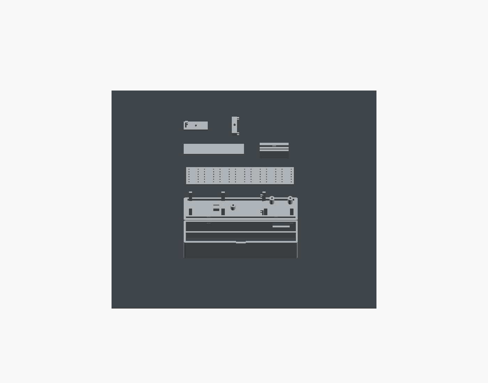

# All parts on one build plate

One G-code file prints **all seven objects** on the Ender-3 V3 KE's 220 × 220 mm bed: the front shell, rear cover, MCU retaining cap, updated 84-hole PCB dummy, MCU channel coupon, two-piece closure coupon and 50 mm scale coupon. The earlier three jobs were separated so small fit tests could be checked first and each job could use its own support settings; bed area does not require that split.

[Download the combined G-code](gcode/B2_F_AllParts_OnePlate_KE04_HyperPLA.gcode), [ZIP with instructions and verification](B2_F_AllParts_OnePlate_KE04_HyperPLA.zip), or [editable sliced Orca project](sliced-projects/B2_F_AllParts_OnePlate_KE04_HyperPLA.3mf).

**Estimated print: 1h 58m 37s / 21.94 g.** Use the stock **Ender-3 V3 KE, 0.4 mm nozzle, grey Creality Hyper PLA 1.75 mm**. Copy the G-code to the printer's USB drive and start it manually. No remote printing was started. This file is for PLA.

All seven meshes retain 100% scale and their previous orientations. The job prints **by layer**, with all objects starting on the bed. The shell alone has snug build-plate supports, a 0.20 mm support contact gap and a 3 mm outside brim. Per-object overrides disable support and brim on all six other objects, preserving their fit surfaces and channels. The native KE homing, 5×5 bed mesh, stock X=-2 mm purge and final parking sequence remain unchanged.

Other settings match the checked individual jobs: 0.20 mm layers, 220→215°C nozzle, 60→55°C bed, cooling off on the first layer then 100%, three walls, five top/bottom layers, 25% gyroid infill, first layer 20 mm/s, outer walls 35 mm/s and zero XY hole/contour compensation.

The independent audit inspects the **actual sliced meshes, per-object settings and executable G-code**. It confirms all seven objects extrude on the first layer; only the shell allocation contains support, support interface and brim extrusion; the minimum gap between allocated objects is 9 mm including the shell brim; every extrusion and motion stays inside the checked KE limits; and the standalone G-code exactly matches the copy embedded in the sliced project. See [verification.json](verification.json) and [the repeatable verifier](verify_single_plate.py).

Let the plate cool before removal. Remove the shell brim/supports, measure the 50 mm coupon and the **89.45 × 17.30 × 1.60 mm** dummy, then follow the [case and physical-fit instructions](../README.md#check-the-physical-assembly). The dummy has 1.0 mm FDM holes; the PCB has 0.90 mm finished holes. Check the actual electronics and USB cable before ordering the custom PCB. Existing CAD, firmware, fabrication files and individual print jobs are unchanged.

