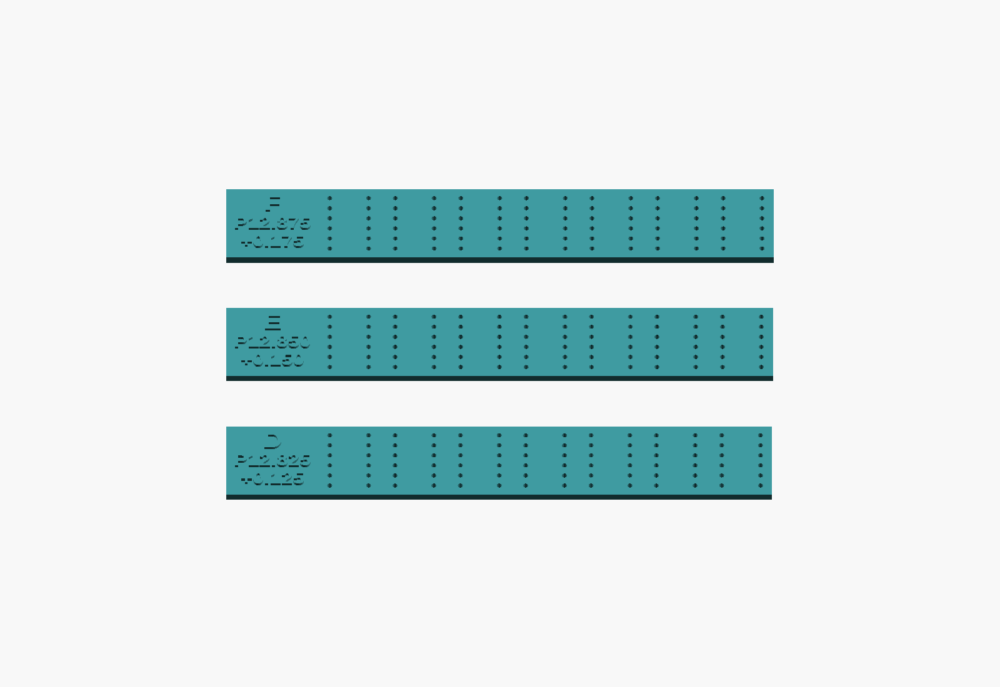

# Fine LED-spacing trials — D / E / F

These follow the earlier A/B/C trials. The owner confirms that the required centre pitch is between **12.80 and 12.90 mm** and requests the following intermediate samples. Each sample fits **all seven modules** and has raised labels outside the LED area, retaining three decimal places.

Download the [ready-to-print G-code](gcode/LED_Pitch_DEF_Fine_KE04_HyperPLA.gcode) or the [ZIP with instructions and verification](LED_Pitch_DEF_Fine_KE04_HyperPLA.zip). **One file prints all three strips and the 50 mm coupon.** OrcaSlicer estimates **1 hour 24 minutes and 11.24 g** of filament. The [sliced Orca project](sliced-projects/LED_Pitch_DEF_Fine_KE04_HyperPLA.3mf) is also included for inspection.

| Label | Centre pitch | Increase per join from 12.700 mm | Increase across six joins |
|---|---:|---:|---:|
| **D / P12.825 / +0.125** | 12.825 mm | 0.125 mm | 0.750 mm |
| **E / P12.850 / +0.150** | 12.850 mm | 0.150 mm | 0.900 mm |
| **F / P12.875 / +0.175** | 12.875 mm | 0.175 mm | 1.050 mm |

All 12 holes within each module retain their original relative centres and 1.0 mm print diameter. Only the spacing between module groups changes. The calculations use exact integer nanometres to preserve the 0.025 mm steps; the old coarse generator's two-decimal rounding is not used.

Each perforated base is 1.6 mm thick with an 18 mm external label tab; raised text reaches 2.2 mm. The perforated core lengths are 89.150/89.300/89.450 mm, excluding the tabs. These are print-only spacing tools, not final PCB/case outlines. Pitch is not the visible air gap between housings.

One G-code file prints D, E and F together, plus the same 50.00 mm calibration coupon. Use the **Ender-3 V3 KE with 0.4 mm nozzle and Creality Hyper PLA grey 1.75 mm**, as before. No supports or brim; 100% scale; 0.20 mm layers; 220→215°C nozzle and 60→55°C bed. Copy the G-code to the printer USB drive and start it manually. No remote printing is started.

## Compare the fits

Let everything cool before removal. Confirm each empty strip lies flat, then reuse the same seven LEDs in the same order and orientation. Keep modules square, pins straight and insertion depth consistent. Choose the smallest spacing that fits all seven without bowing or force. Report D/E/F and the 50 mm coupon's caliper reading; check the other 14 modules before fixing the geometry for three displays.

The 0.025 mm differences are **nominal CAD settings, not a claim of 25 µm printer accuracy**. Over the full six joins, adjacent trials differ by 0.150 mm. Judge the complete assembly and scale coupon rather than a single tiny gap. If the empty prints bow or differences are inconclusive, report that instead of forcing a selection.

The current 12.700 mm PCB and case remain on hold until the chosen fit is applied and rechecked. Their geometry and firmware have not been changed by these tests. The older A/B/C files are preserved separately.

## Files and checks

`models/` contains the labelled SCAD/STL files; `projects/` the prepared Orca project; `sliced-projects/` the native sliced project with embedded G-code; `gcode/` the standalone printer file. `preparation.json` records exact coordinates and hashes. `verification.json` independently checks actual STL hole centres, intramodule patterns, labels, sliced geometry, executable G-code, machine settings and motion bounds. `slice-provenance.json` records the successful slicing command and delivered hashes. All electronic CAD and firmware files are retained unchanged.

