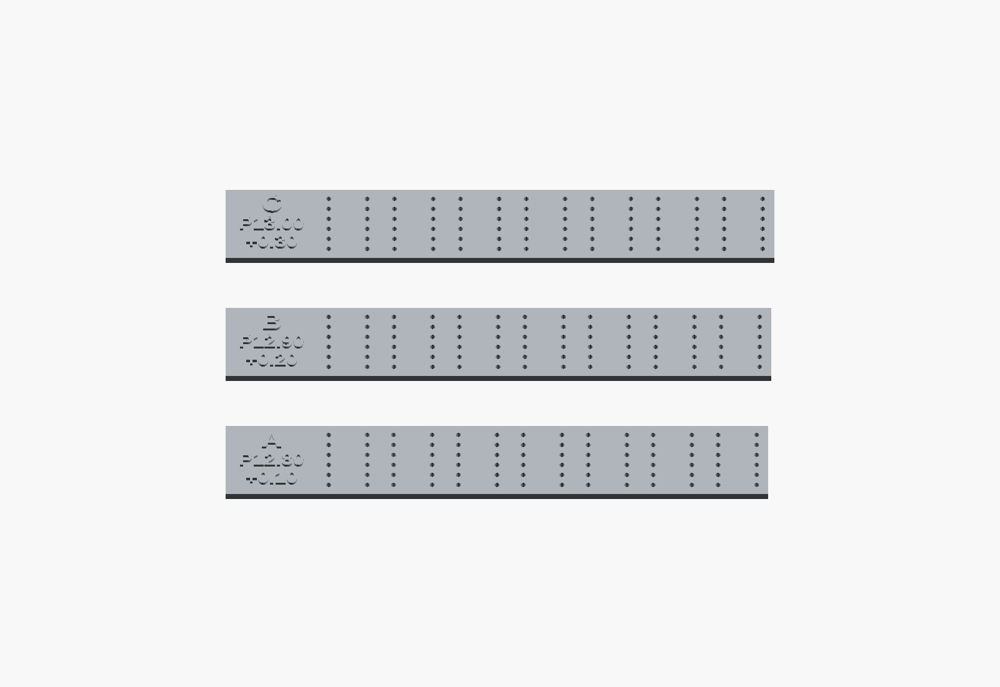

# Labelled seven-module spacing trials — 30 October 2026

**Follow-up:** the owner has narrowed the required pitch to 12.80–12.90 mm. Use the [new D/E/F fine trials](../fine-pitch-tests-2026-10-30/README.md) for 12.825/12.850/12.875 mm. This A/B/C set remains preserved for reference.

Use this set before ordering a PCB. The owner reports that the individual 12-hole patterns fit, but the complete fitted strip bows. The two photos are consistent with slight body interference, while perspective and possible print warpage prevent an exact measurement. The earlier caliper estimate of about 12.9 mm body width makes **B the middle, best-guess trial**, with A and C bracketing it. This is a test range, not a measured answer from the photographs.

One G-code file prints **all three full seven-module strips**, plus a separate 50.00 mm scale coupon:

**[Ready-to-print G-code](gcode/LED_Pitch_ABC_KE04_HyperPLA.gcode)** · [Editable sliced Orca project](sliced-projects/LED_Pitch_ABC_KE04_HyperPLA.3mf)

[ZIP download with instructions](LED_Pitch_ABC_KE04_HyperPLA.zip): unzip it and copy the `.gcode` file to the printer's USB drive.

| Raised label | Module centre spacing | Increase at each join | Increase across six joins | Perforated core length |
|---|---:|---:|---:|---:|
| **A / P12.80 / +0.10** | 12.80 mm | 0.10 mm | 0.60 mm | 89.00 mm |
| **B / P12.90 / +0.20** | 12.90 mm | 0.20 mm | 1.20 mm | 89.60 mm |
| **C / P13.00 / +0.30** | 13.00 mm | 0.30 mm | 1.80 mm | 90.20 mm |

`P` means **centre pitch**, not the visible air gap between bodies. The actual gap depends on the owned housings. The previous pitch was 12.70 mm. Each strip has an extra 18 mm label tab outside the LED area; the letters and numbers are actual raised plastic, not just filenames. Overall test-piece lengths including tabs are 107.0/107.6/108.2mm. These tabbed samples are spacing tools, not replacement case-fitting dummies or final PCB outlines.

Native OpenSCAD preview of the actual trial meshes; C is at the top, B in the middle and A at the bottom. This is a CAD view, not a photograph.

All **12 hole centres within each module stay unchanged**. Only translation between module groups increases. Hole diameter stays 1.0 mm, as in the earlier printed fit tools; the production PCB's finished holes are 0.90 mm. The perforated base is 1.60 mm thick; raised labels reach 2.20 mm overall. Do not globally scale a sample, as that would also alter the individual pin pattern.

## Printing

For **Creality Ender-3 V3 KE, 0.4 mm nozzle**, with **Creality Hyper PLA grey, 1.75 mm**. Copy the G-code to the printer USB drive and start it manually. No remote printing was started.

- OrcaSlicer 2.4.2 estimate: **1h 24m 38s / 11.28 g**, plus real heating/levelling variability.
- Nozzle 220°C first layer, 215°C thereafter; bed 60°C first layer, 55°C thereafter.
- 0.20 mm layers, 100% scale, three walls, five top/bottom layers; the 1.6 mm perforated strips are solid.
- No supports, brim or raft. Slow small perimeters and full cooling after layer one.
- The proven native KE homing, bed mesh, X=−2 mm purge and parking are preserved.

Let the plate cool fully before removing the thin strips. The plain short rectangle is the 50 mm scale coupon, not a fourth spacing variant. The three long samples can be reused with the same seven LEDs.

## Fit test and result to report

1. Measure the 50 mm coupon and note the reading. Check every **empty** strip against a flat surface first. If it is already curved or rocks, record that before inserting LEDs; printed warpage would confound the spacing test.
2. Use the same seven modules as in the photos, in the same order and consistent orientation, for each trial. Start with B. Insert gently, keeping bodies square and pins straight. Do not force neighbouring housings together or use the strip to bend leads. Keep a consistent insertion depth, ideally the intended 3 mm body-to-board stand-off.
3. Check all seven together. Look along the strip from the end and side: it should remain flat, with parallel module faces and no sideways pressure needed. A tiny natural gap is acceptable. Stop if a trial starts bowing or needs force.
4. If B is flat, try A to find whether the smaller increase suffices. If B is still tight, try C. Choose the **smallest pitch that fits without force or bowing**. If all three bow, or every empty strip was already bowed, report that rather than selecting C by default.
5. Tell us the winning letter, the 50 mm coupon measurement and whether the empty/fitted strip was flat. A photo from the side is useful. After choosing a candidate, also try the other 14 owned modules in two groups of seven before committing three displays to one PCB layout.

The current PCB and case still use 12.70 mm repeat. **Do not order the old PCB yet.** A chosen trial must be reconciled with PCB pad/edge clearances, component placement, routing, the case and a matching quote. The wider test-strip outlines preserve old end margins for comparison; they do not decide the final PCB width. No PCB, schematic or firmware geometry has been changed by this test preparation.

## Source and verification

`prepare_pitch_tests.py` derives the 84 holes from the audited B2 PCB and applies only the documented per-module translations. It uses the same validated KE/PLA profile and the existing native 3MF writer, with a separate output directory. Original case and PCB files are retained.

`preparation.json` records exact hole coordinates, source/model hashes and plate placement. `verification.json` contains an independent audit of the meshes and executable G-code. `slice-provenance.json` links the successful Orca command, input, sliced project, exported G-code and preview. The original owner observations are recorded in [the spacing review](../../reports/owner-spacing-review-2026-10-30.json). These checks establish represented geometry and printer instructions, not an actual physical fit.
