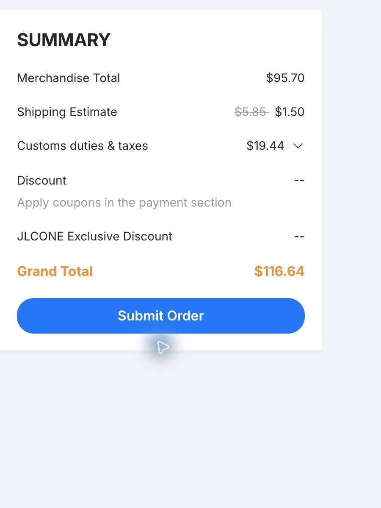
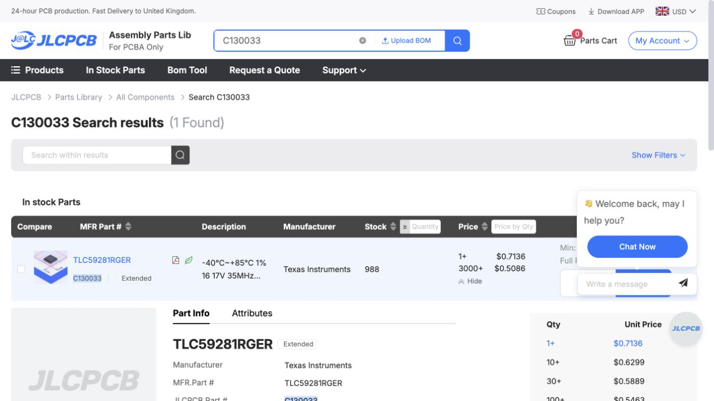

# Stocked drivers and alternative manufacturers — 31 October 2026

**Historical investigation:** the owner subsequently authorised the TLC59283/7.15k engineering revision and selected three displays plus extra screws/wire. See the [current revision and check record](../../reports/TLC59283-2026-10-31/README.md). Statements below that canonical B2 still uses TLC59282 describe the state when these quotes were collected; the quoted cart itself remains a cost-only draft.

**The best balanced candidate to qualify is JLCPCB with TLC59283RGER / C485815 and four 7.15 kΩ current-setting resistors / C25980.** It fits the existing driver/resistor pads and can keep the 12.875 mm LED pitch, board outline, case, wiring, resolution, artwork and intended brightness. It retains grouped output switching and has a lower internal-current planning allowance. All **55 SMT placements in 18 BOM groups** matched available JLC parts. The slightly cheaper TLC59281 was also investigated and quoted fully.

This is a compatibility/quotation investigation, **not a replacement manufacturing release**. Canonical B2 CAD, firmware, BOM and manufacturing files still specify TLC59282RGER. No PCB order, component purchase or payment was submitted. Neither candidate matches every original electrical specification. In particular, TLC59283 adds precharge; rail-transient and powered acceptance remain necessary before promising identical physical performance.

## Cost comparison

| Factory and exact scope | 5 fabricated / 2 assembled | 5 fabricated / 5 assembled | What remains outside this number |
| --- | ---: | ---: | --- |
| **JLC, balanced TLC59283 + 7.15 kΩ, all 55 SMT parts** | **$95.70 goods** | **$110.32 goods** | UK shipping, VAT, depanel/review |
| **JLC, candidate TLC59281, all 55 SMT parts** | **$91.82 goods** | **$106.92 goods** | UK shipping, VAT, depanel/review |
| **NextPCB, unchanged TLC59282 design, all 55 SMT parts** | **$179.23 goods** | **$214.51 goods** | UK shipping, VAT, final CAM/tooling/review |
| **PCBWay, unchanged-design calculator estimate** | **$602.40** | **$602.40** | All components, VAT, manual-review adjustments; delivery promotion included |

These are not equivalent final invoices. NextPCB matched all 18 original BOM groups and already applied its assembly promotion; PCBWay's calculator explicitly excludes component costs. Both competitors still need CAM approval of the unchanged 0.075 mm via annuli. PCBWay's form also cannot specify the required 0.5 oz inner copper without manual clarification. Its estimate is not represented as an exact manufacturable-board quotation.

At these observed prices, neither competitor appears likely to beat JLC for this prototype. The owner subsequently limited supplier emailing to cases with a realistic chance of price competitiveness. **PCBWay and NextPCB email drafts therefore remain unsent.** PCBWay's prepared contact form required CAPTCHA; NextPCB's earlier authorised web-contact attempt returned a failure/reset, with no confirmed receipt. No further contact attempts were made after the owner's price condition.

Manufacturer capabilities, promotions, actual calculator settings and evidence: [manufacturer comparison](manufacturers/README.md), [live prices](manufacturers/live-calculator-results.json). The PCBWay figure uses the corrected **4/4 mil** routing option, not an unnecessary 3/3 mil option. Removing required via filling would change the product/process and is not counted as a saving.

## Complete-product budgets with TLC59283 and 7.15 kΩ

JLCONE actually confirmed **$1.50 promotional tracked delivery for both quantities** with this candidate. No $30 voucher or random desktop discount is deducted. The earlier browser-only TLC59281 quotes used $6.37/$7.47 freight and are retained separately; do not mistake their different-channel landed totals for an equal-shipping component comparison.

| Complete purchase alternative | JLC incl. observed shipping/VAT and depanel allowance | Remaining retail purchases incl. UK delivery/VAT | Complete budget |
| --- | ---: | ---: | ---: |
| **2 finished displays**, plus 3 bare PCBs | £89.17 | £53.20 | **£142.37** |
| **3 finished displays**, plus 2 populated spare main PCBs | £103.16 | £65.09 | **£168.25** |
| **5 finished displays** | £103.16 | £118.86 | **£222.02** |

Practical planning amounts are approximately **£150 / £175 / £230**, respectively, rather than guaranteed ceilings. Five finished displays include 14 further LEDs; the existing 21 cover three. The middle row pays for five assembled mains but finishes only three products. Economic assembly currently offers two or five populated boards, rather than three.

The remaining retail list is unchanged: XIAO RP2040 Plus, Adafruit 4090 USB-C breakout, thin stranded wire, appropriate screws/key, and electronics-safe strain relief. Owned LEDs, printer/filament, soldering iron/stand, solder/flux, cutters/strippers, multimeter, suitable USB supplies and USB-C/data cables are retained as requirements but cost **£0 new spending**. [Itemised shopping list and delivery evidence](../updated-F-2026-10-31/retail/README.md).

The two-board factory quote is $49.94 fabrication + $45.76 assembly. Actual native checkout is $95.70 goods + $1.50 delivery + $19.44 VAT = **$116.64**. A further $2.32 depanel allowance, with 20% VAT, gives **$119.42** budgeted factory total. For five, $49.94 + $60.38 assembly = $110.32 goods; checkout adds $1.50 shipping and $22.37 VAT = **$134.19**. Adding $3.31 depanel plus VAT gives **$138.16**. Advanced options and remarks remain subject to review. Use JLC's actual VAT total, including its one-cent invoice-rounding difference on five boards.

GBP uses the earlier same-day rate **$1 = £0.7467**; actual card exchange/fees may differ. Retail shipping allowances and prototype remake costs remain as described in the detailed retail record. The model rounds the depanel-with-VAT allowance to cents, then converts the combined USD total. [Balanced candidate quotes/calculation](jlc-59283-7p15k-cost-only/complete55-quotes.json), [earlier TLC59281 quotes/calculation](jlc-59281-cost-only/complete55-quotes.json).

Compared with the previous original-driver sourcing model, this saves about **£14.50 for two complete displays**, or **£25.32 for either five-board scenario**, before any additional discount. The saving includes avoiding the original part's separate sourcing minimum/handling; it is not just a per-chip saving. A possible $30 voucher remains conditional on the payment-stage rules and is not deducted.

## Why qualify TLC59283 with matched current

JLC showed **3,117 TLC59283 drivers** and **61,580 matching 7.15 kΩ resistors** in stock. Our nominal-current calculation gives **7.4001 mA**, 0.335% below the original 7.4249 mA. The same scan timing and brightness setting can remain. The driver/resistor change adds only **$3.88 for the two-board goods quote or $3.40 for five** compared with TLC59281, mostly the extra resistor-type setup fee.

The follow-up review favours its power and switching balance: approximately **24 mA less full-brightness planning current than the original**, while retaining grouped output transitions. It still has different tolerance limits and adds output precharge. No steady-powered PMOS-gate incompatibility was identified, but the datasheet's powered leakage test does not establish VCC=0 reverse-current behaviour. Existing switched rails/QOD reduce the risk; they do not prove transient safety. Verify precharge, startup/shutdown, gate/anode waveforms, brightness uniformity, USB current/suspend and case temperature on the prototype. [TI datasheet](https://www.ti.com/lit/ds/symlink/tlc59283.pdf), [matched-current follow-up and calculations](driver/tlc59283-matched-current-followup.md).

## Cheapest component option: TLC59281

JLC's live library and assembly matcher showed **988 TLC59281RGER / C130033** in stock, at **$0.7136 each for 1+ or $0.6299 for 10+**. Stock is not reserved. The candidate has the same 24 terminals plus grounded exposed pad and RGE0024C land pattern as the original, so no copper routing or case edit is inherent in the substitution.

With the existing 6.8 kΩ resistors, our calculation gives **7.4118 mA nominal LED current**, versus 7.4249 mA originally, a **0.177% reduction**. The same 400 Hz frame, five-column scan, brightness setting and USB programming arrangement can remain. Its latch is edge-triggered and overwrites the shift register; the existing firmware already sends fresh 64-bit data before each single 1 µs latch pulse. A separate 1,000-frame destructive-latch model passed.

This is not an assertion that the chips are identical. The candidate's specified maximum device-current error is wider at the stated datasheet test condition; its internal-current planning allowance adds approximately **11 mA at full brightness**, and outputs switch simultaneously rather than in staggered groups. First-board checks must include bank brightness uniformity, supply/current qualification, false clocks/ghosting, USB suspend and all-on case temperature. Retain both switched rails and the existing shutdown/wake sequence. [TI datasheet](https://www.ti.com/lit/ds/symlink/tlc59281.pdf), [pin/timing/current investigation](driver/README.md).

The later TLC59283/7.15 kΩ review above is the balanced alternative to this cheapest component option. Leaded-package alternatives would require placement/routing changes and have weaker mechanical prospects in this narrow board. The study prioritises pin-compatible QFN candidates over a large architectural redesign.

## Original-driver restocking: actual support result

After the owner approved contacting JLC, an authenticated support conversation asked about incoming stock, domestic procurement, MOQ/attrition and complete assembly pricing for 8 or 20 installed drivers. Support confirmed **no restock schedule is currently available** and directed us to a no-payment parts quotation request.

That request was submitted successfully for **20 TLC59282RGER and 20 TLC59282RGET as alternative sourcing enquiries**, not a purchase of 40 chips. Quote History shows **0 of 2 parts quoted, status “Quoting”**. The chat also contains the two-board eight-chip requirement. Neither request buys or reserves anything. Prices/lead times are pending; a cheaper original-driver sourcing result could still make keeping the original part attractive. [Verified support outcome](restock/live-support-outcome.json).

The catalogue restock path has no published fixed arrival date. JLC's assembly and LCSC inventories are separate; external distributor/LCSC stock is not ready JLC assembly inventory. [Official FAQ](https://jlcpcb.com/help/article/pcb-assembly-faqs-part-2).

## Before adopting or ordering

The isolated [TLC59281 inputs](jlc-59281-cost-only/input-manifest.json) and [TLC59283/7.15 kΩ inputs](jlc-59283-7p15k-cost-only/input-manifest.json) are labelled **COST-ONLY / NOT RELEASED**. Actual quote matching was done manually on the original uploaded BOM rows; the old source comments in the quote UI still read TLC59282/6.8 kΩ. Assembly remarks explicitly identify the selected alternative MPNs, the discrepancy and the no-order instruction. The final saved cart item is labelled `ALT-TLC59283-7p15k-COST-ONLY-NOT-APPROVED` and deselected.

A chosen substitution needs a separate documented revision: update part identity and protocol/power documentation consistently, rerun ERC/DRC/netlist/placement/firmware and manufacturing checks, then obtain factory CAM/pin-1 approval. Those engineering-release edits were not made as part of this options investigation. The already confirmed physical pitch, outline and case can be preserved. Real powered acceptance remains necessary for either driver.
