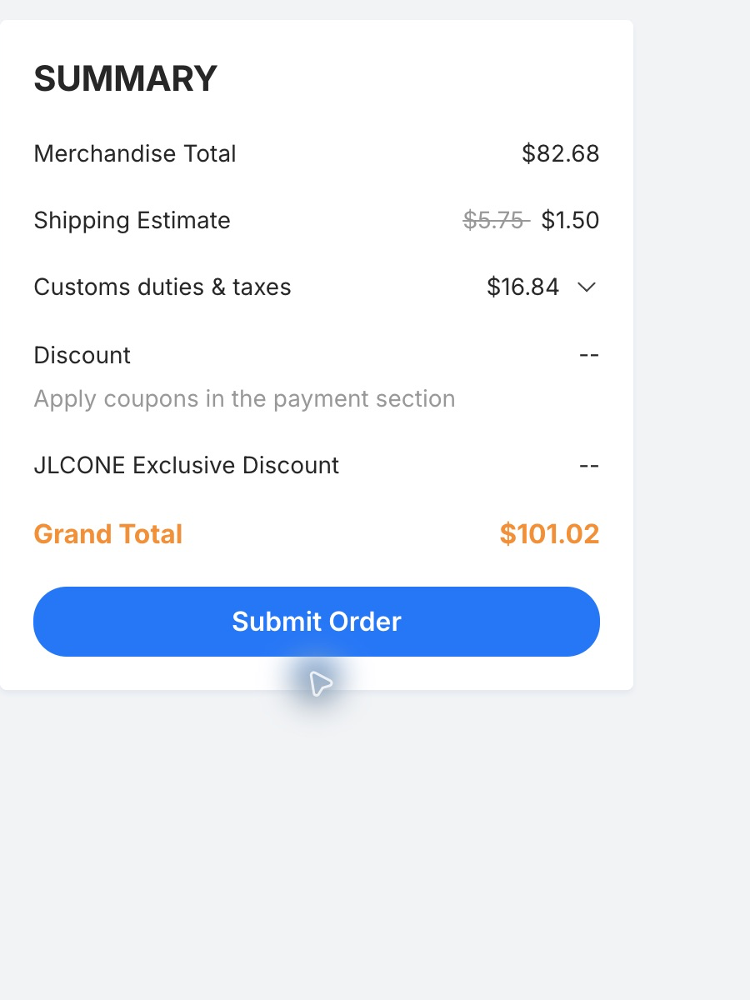

# B2 confirmed F — remaining-purchase budget, 31 October 2026

**Plan approximately £165 for two finished displays, £200 for three finished displays plus two populated spare main PCBs, or £255 for five finished displays.** These are provisional budgets, including delivery and VAT allowances, using the owner's existing LEDs, tools, filament, USB supplies and cables. No order or payment was submitted in this quotation session.

**A firm, complete JLCPCB quotation is currently blocked by driver inventory.** Both compatible QFN catalogue listings, TLC59282RGER/C702074 and TLC59282RGET/C202205, show zero JLC stock. An exact-part Global Sourcing route through Mouser is available as an unpaid preview. JLC only allows those parts into an assembly order after they reach its warehouse. Consequently the factory checkout screenshots below cover **51 of the required 55 SMT components per board**. They cannot produce working displays on their own and must not be ordered.

## Complete-product comparison

| Alternative purchase | Custom fabrication/assembly and driver sourcing, modeled incl. tax | Remaining retail purchases incl. UK delivery/VAT | Modeled total | Planning amount |
| --- | ---: | ---: | ---: | ---: |
| **Smallest sensible complete batch: 2 finished displays**, plus 3 bare PCBs | £103.67 | £53.20 | **£156.87** | **£165** |
| **Recommended for the owner's intended 3 displays:** 5 populated main PCBs, finish 3, retain 2 populated main PCBs as spares | £128.48 | £65.09 | **£193.57** | **£200** |
| **Best unit value among the priced complete batches: 5 finished displays** | £128.48 | £118.86 | **£247.34** | **£255** |

The Economic assembly form offers **2 or 5 assembled boards** when fabricating 5; it did not offer 3. Five fabricated with two assembled means five boards altogether, not seven. The optional middle row explicitly includes the cost of all five populated mains but only three sets of retail modules, screws and wiring. It is not a quote for five complete displays. Standard assembly for three was not quoted, so this does not claim every possible factory service has been compared.

Two complete displays cost about £78.44 each; five cost about £49.47 each. For the intended three, spending about £36.70 more than the two-display model finishes the third and retains two populated main PCBs. Finishing all five instead adds £53.77 of retail purchases, including 14 further LEDs: the owner's existing 21 cover three displays.

The planning amounts provide modest headroom, **not guaranteed caps**. They exclude unverified coupons. They also exclude electricity and the consumed value of already-owned filament; no new filament purchase is budgeted. A failed prototype requiring a revised PCB batch is not included.

## Discounts and the lowest possible total

The signed-in cart previews the already-claimed **$30 High-Layer PCB voucher**. The last observed expiry is 27 December 2026. However, checkout explicitly says coupons apply in the payment section, reached after **Submit Order**. That button was not clicked. Both final pre-submission coupon and JLCONE instant-discount fields show `--`.

If that voucher is accepted, it could save about **£22.40**, or **£26.88 if it also reduces the 20% VAT base**. That would put the modeled totals around **£130–£134 for two**, **£167–£171 for three plus two spare mains**, or **£220–£225 for five**. These are conditional savings, not payable quotes. The recorded freight-above-$5 voucher condition needs particular attention because JLCONE currently discounts delivery to $1.50. The cart preview alone does not resolve compatibility.

No stronger applicable creator code was verified. Coupon bundles cannot be summed into one discount. The EasyEDA-only and size-limited new-user offers are not counted. No random JLCONE $1–$20 discount is assumed. [Official coupon instructions](https://jlcpcb.com/help/article/how-do-i-use-a-coupon-for-my-order), [JLCONE offer](https://jlcpcb.com/news/jlcpcb-jlcone-desktop-app), [research record](discount-research.json).

There is a further potential **£4.62 saving on the five-board scenarios** by sourcing exactly 20 drivers rather than the conservative 25-chip allowance, **if JLC confirms that no extra attrition chips are needed**. The 20-chip preview is $38.10 + $1 handling = $39.10. The main model allows 25 chips at $44.26 to avoid treating a zero-spare purchase as sufficient before the assembly calculator confirms it. Five spare chips are a budget choice, not a claimed factory requirement.

## What JLC actually quoted

The current uploaded archive is the **12.875 mm-pitch, 89.45 × 17.30 mm** revision. JLC detected six layers. Its copied inputs and hashes are in [inputs/input-manifest.json](inputs/input-manifest.json); no older 12.700 mm archive was used.

| Live incomplete factory baseline, USD | 2 partially populated + 3 bare | 5 partially populated |
| --- | ---: | ---: |
| Fabricate 5 PCBs | $49.94 | $49.94 |
| Assemble the available 51 SMT components | $32.74 | $40.45 |
| Goods subtotal | $82.68 | $90.39 |
| JLCONE Global Standard Direct Line shipping | $1.50 | $1.50 |
| Actual pre-submission UK VAT | $16.84 | $18.38 |
| Checkout total, **missing all four drivers per board** | **$101.02** | **$110.27** |
| Additional depanel allowance, before VAT | $2.32 | $3.31 |

These are **not complete-display prices**. They match 17 of 18 BOM groups, omitting U1–U4. Fresh JLC quote screens explicitly exclude depanel from the total and say advanced-option charges are finalized after review. The earlier native screen included the fee inline; the budget retains it rather than treating its checkout omission as free depanel. Other assembly remarks can also receive a charge after review.

The quote uses 1.6 mm green TG135 FR4, ENIG 1 µin, 1 oz outer / 0.5 oz inner copper, ordinary 0.30 mm drills, filled/capped vias, no optional deburring, bottom Economic assembly, manual CAM and placement confirmation, and depanel before delivery. All 84 LED holes must stay open; only the 276 smaller vias are filled. Final outline excludes temporary external assembly rails. Native rotations were not approved or edited. The quote is subject to CAM and feeder/pin-1 review.

The cheaper $1.50 shipping was verified in JLCONE for both quantities; normal displayed rates were $5.75/$6.36. Browser checkout for two showed $5.75 rather than this desktop promotion, so JLCONE is the cheaper observed channel. Quoted transit is **8–12 business days after shipping**, separate from component sourcing and manufacturing. Fabrication showed 7–8 days and assembly 3–4 days plus a day for options; these are estimates, not a delivery promise.

The final saved PCB cost draft is visibly labelled `INCOMPLETE-DRIVERS-MISSING-DO-NOT-ORDER` and deselected. Other historical cart jobs were preserved. Canonical CAD, BOM, placement files and firmware were not changed for pricing.

## Exact driver sourcing

JLCONE's signed-in Global Sourcing search lists **Mouser 595-TLC59282RGER**, stock 1,417, MouseReel, **MOQ 13**, estimated **10–20 business days**. The cheapest observed low-quantity exact-part route is:

| Driver quantity | Intended installed quantity | Goods | Handling | Procurement preview, USD |
| --- | ---: | ---: | ---: | ---: |
| 13 | 8 for two boards | $24.77 | $1.00 | **$25.77** |
| 20 | 20 for five boards, no spare allowance | $38.10 | $1.00 | **$39.10** |
| 25 | 20 for five boards, five spare allowance | $43.26 | $1.00 | **$44.26** |

These unpaid sourcing previews stop at an unfilled billing form. Their final UK tax treatment has not been verified. The budget applies 20% once across sourcing, fabrication, assembly and freight as a **tax allowance**, not as a confirmed invoice assessment across the two transactions. Do not add another 20% to these modeled totals without reconciling the final invoices.

The main model adds an **estimated** $3.09 driver-type loading fee plus $0.34/$0.84 extra placement labor to the observed 51-SMT assembly totals. Those increments are not a complete factory quote. Sourcing attrition, possible handling/review charges, taxes and the final 55-SMT assembly total remain to be confirmed. [Full calculation](provisional-complete-budget-model.json), [live procurement evidence](live-global-sourcing.json).

JLC's rules require sourcing into its warehouse before using the parts for PCBA; unused globally sourced chips normally remain there rather than being delivered loose with the boards. The sourcing purchase and PCB assembly purchase are separate steps. Neither was submitted. [Official sourcing guide](https://jlcpcb.com/help/article/how-to-use-jlcpcb-global-sourcing-parts-service).

RGET is the manufacturer's same-device alternative reel option, but its observed Mouser price was higher. The available DBQR/SSOP TLC59282 listing does **not** fit this QFN PCB. TLC59283 is not an approved substitution. No driver redesign or hand-soldered QFN workaround was introduced. [TI carrier evidence](https://www.ti.com/product/TLC59282/part-details/TLC59282RGER).

## Remaining shopping list

Retail figures below include VAT and the delivery charges/allowances in the [detailed retail record](retail/README.md). They count purchased pack sizes and whole wire lengths, not just the fraction consumed. Prices can change before checkout.

| Supplier / purchase | 2 finished | 3 finished | 5 finished |
| --- | ---: | ---: | ---: |
| [UnmannedTech: headerless XIAO RP2040 **Plus**](https://www.unmannedtechshop.co.uk/products/seeed-studio-xiao-rp2040-plus), one each | £12.57 | £17.06 | £26.04 |
| [Pi Hut: Adafruit **4090** USB-C downstream breakout](https://thepihut.com/products/adafruit-usb-c-breakout-board-downstream-connection-ada4090), one each | £9.60 | £12.50 | £18.30 |
| [Saber Armory: 28 AWG stranded PTFE wire, 0.71 mm OD](https://thesaberarmory.com/products/28awg-ptfe-bs-spec-hook-up-wire-1-metre-lengths), 1 m red + 1 m black + 2/3/5 m blue | £11.40 | £13.20 | £16.80 |
| [Bolt Base: ISO 7380-1 M2 button-head screws](https://boltbase.com/products/m2-self-colour-10-9-high-tensile-socket-button-head-screws-iso-7380-1), two M2×6 + one M2×8 each; one shared [1.3 mm hex key](https://boltbase.com/products/1-3mm-metric-short-arm-hex-keys-din-911) | £9.80 | £12.50 | £17.90 |
| CPC: shared [electronics-grade silicone](https://cpc.farnell.com/chip-quik/egs10c-20g/silicone-adhesive-sealant-20g/dp/SA03781) and [100 × 2.5 mm cable ties, 100-pack](https://cpc.farnell.com/pro-power/pp01582/cable-tie-100x2-5mm-blk-100pk/dp/CBBR6697?gross_price=true) | £9.83 | £9.83 | £9.83 |
| [Switch Electronics: additional matching LED modules](https://www.switchelectronics.co.uk/products/red-5-x-7-dot-matrix-led-display-17-8x12-7mm), 14 needed only for five finished displays | £0 | £0 | £29.99 |
| **Remaining retail spend** | **£53.20** | **£65.09** | **£118.86** |

UMT, Pi Hut and Bolt Base totals use exact-quantity anonymous carts and delivery rates. Wire/LED goods VAT was checked, with conservative shipping-VAT allowances. CPC uses its official catalogue and published small-order handling charge, not an address-locked final checkout. CPC reduces the prior strain-relief basket by £8.65 per batch without changing the specified adhesive/tie method. If a 1.3 mm hex key is already owned, subtract £0.50. Do not buy generic taller screw heads or thicker wire without a fit check.

**Required, already owned, £0 new spending:** 21 LEDs; Ender-3 V3 KE; grey Hyper PLA; soldering iron and stand; solder/flux; suitable strippers and flush cutters; multimeter; suitable 5 V USB supplies; USB-C cables. A data-capable cable is required for programming. Two, three or five displays running independently need that many suitable supplies/cables, taken from the owner's existing inventory. No tool, PSU, cable or solder replacement purchase is included.

## What the money produces

Once procurement is resolved, the intended purchase is **one custom main PCB design with all 55 small components factory assembled**, plus ready-assembled XIAO and USB breakout modules. B2 does not require a second custom USB PCB. The owner still solders seven LEDs and 20 connecting wires per display (84 LED joints and 40 wire joints), fits strain relief/screws, installs the printed case and loads the UF2 firmware. There is no QFN chip assigned to hand soldering.

This remains a first hardware prototype. The confirmed F mechanical pitch, current digital/design checks and printed fit tests do not replace powered-board acceptance. The case print, actual stock-module/USB-plug fit, factory CAM/pin-1 review and first-board supply/USB/thermal tests remain the gates before committing to a larger batch.

JLC charges USD. GBP calculations use **$1 = £0.7467** from the [Wise USD/GBP page](https://wise.com/gb/currency-converter/usd-to-gbp-rate) checked 31 October; card rates and fees may differ. Private addresses, phone numbers, emails and checkout/session URLs are excluded from the saved evidence. All public screenshots were checked/cropped before saving this record.
